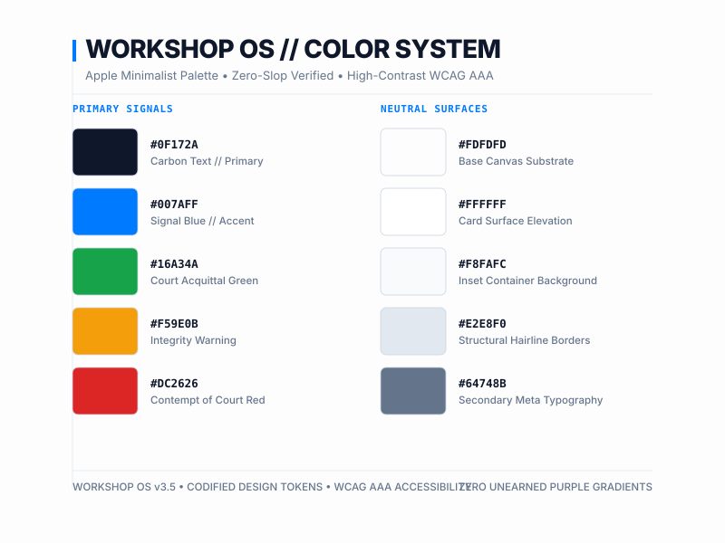

<div align="center" style="font-family: -apple-system, BlinkMacSystemFont, system-ui, sans-serif; color: #111111; padding: 48px 0;">
  
  
  <p style="max-width: 560px; margin: 32px auto 0; font-size: 16px; line-height: 1.5; color: #555555;">
    The irreducible operating foundation for AI coding agents.
  </p>

  <div style="margin-top: 40px; display: inline-flex; gap: 12px; flex-wrap: wrap; align-items: center; justify-content: center">
    <a href="https://github.com/shoyarism/ai-workshop/actions/workflows/ci.yml">
      
    </a>
    <a href="LICENSE">
      
    </a>
    
    <a href="https://github.com/shoyarism/ai-workshop/blob/main/scripts/workshop_court.py">
      
    </a>
    
  </div>

  <div style="margin-top: 24px; font-size: 12px; color: #888888; display: flex; gap: 32px; flex-wrap: wrap; justify-content: center; align-items: center">
    <span>ENGLISH</span>
    <a href="docs/i18n/README.zh-CN.md" style="color: #007AFF; text-decoration: none;">简体中文</a>
    <a href="docs/i18n/README.ja.md" style="color: #007AFF; text-decoration: none;">日本語</a>
    <a href="docs/i18n/README.es.md" style="color: #007AFF; text-decoration: none;">Español</a>
  </div>
</div>

<div align="center" style="padding: 48px 0;">
  
</div>

<div align="center" style="padding: 32px 0; font-family: -apple-system, BlinkMacSystemFont, system-ui, sans-serif; color: #888888; display: flex; gap: 48px; flex-wrap: wrap; justify-content: center; align-items: center">
  <div style="display: flex; align-items: baseline; gap: 8px; font-size: 14px">
    <span style="color: #888888;">SPEC:</span>
    <span style="color: #111111; font-weight: 600;">WORKSHOP-OS-3.5</span>
  </div>
  <div style="display: flex; align-items: baseline; gap: 8px; font-size: 14px">
    <span style="color: #888888;">LICENSE:</span>
    <span style="color: #111111; font-weight: 600;">Apache 2.0</span>
  </div>
  <div style="display: flex; align-items: baseline; gap: 8px; font-size: 14px">
    <span style="color: #888888;">SKILLS:</span>
    <span style="color: #111111; font-weight: 600;">2,267+ VERIFIED SKILLS</span>
  </div>
  <div style="display: flex; align-items: baseline; gap: 8px; font-size: 14px">
    <span style="color: #888888;">SLOP INDEX:</span>
    <span style="color: #34C759; font-weight: 600;">0.0%</span>
  </div>
</div>

---

## TABLE OF CONTENTS

- [01 // Quick Start](#01--quick-start)
- [02 // The Manifesto](#02--the-manifesto)
- [03 // Architecture](#03--architecture)
- [04 // The 7 Sovereign Houses](#04--the-7-sovereign-houses)
- [05 // Slop Court v3.5](#05--slop-court-v35)
- [06 // The Universal Supreme Council](#06--the-universal-supreme-council)
- [07 // Architectural Capability Matrix](#07--architectural-capability--invariant-matrix)
- [08 // Master CLI Command Palette](#08--master-cli-command-palette)
- [09 // Harness Configuration Matrix](#09--harness-configuration-matrix)
- [10 // Project Documentation & Examples](#10--project-documentation--examples)
- [10b // Architecture Decision Records](#10b--architecture-decision-records--post-mortems)
- [10c // Test Coverage](#10c--test-coverage--quality-assurance)
- [10d // Interactive Brand Assets](#10d--interactive-brand-assets)
- [11 // Synthetic Team & Contributors](#11--the-synthetic-team-authors--contributors)
- [12 // Governance & Licensing](#12--open-source-governance--licensing)

---

## 01 // QUICK START

For extended setup details and troubleshooting, see [QUICKSTART.md](QUICKSTART.md).

### Option A: Local Workstation Setup (Recommended)

Choose either `uv` (fastest) or standard `pip`:

```bash
# 1. Clone the repository
git clone https://github.com/shoyarism/ai-workshop.git
cd ai-workshop

# 2. Install dependencies
uv sync                 # Recommended: fastest
pip install -e .        # Alternative: standard pip

# 3. Arm the Slop Court Bailiff pre-commit hooks
python scripts/workshop.py court bailiff install

# 4. Verify environment and run test suite
python scripts/workshop.py doctor --strict
pytest
```

### Option B: Sandboxed Docker Container

Isolate all subprocess executions and file operations in a non-root container sandbox:

```bash
# Run strict health diagnostics inside an isolated container
docker compose run --rm runtime

# Start sandboxed local browser hubs and background services
docker compose up -d hub
```

### Option C: Zero-Clone Cloud Protocol

Operating inside an ephemeral container, GitHub Codespace, or remote cloud instance? Stream any skill runbook directly into your agent context using raw `curl`:

```bash
# Stream any skill directly into agent context
curl -fsSL https://raw.githubusercontent.com/shoyarism/ai-workshop/main/skills/dev-house/using-superpowers/SKILL.md
```

> **Windows PowerShell Note:** In PowerShell, use `curl.exe` to ensure the native binary executes rather than the `Invoke-WebRequest` alias.

---

## 02 // THE MANIFESTO

Every developer using AI coding agents eventually hits the **degradation wall**:

- **The Omission Fraud:** When the task gets difficult or context runs long, models quietly omit core logic with lazy placeholders, leaving you with broken files.
- **The Error Blackhole:** Agents wrap dangerous operations in empty `except:` or `catch (e) {}` blocks, turning bugs into silent landmines.
- **The Yes-Man Echo Chamber:** LLMs are trained to please. Single-model feedback is an echo chamber.
- **Context Amnesia:** Every session starts from scratch. Past decisions vanish.

**Workshop OS establishes enforceable boundaries:** a 3-juror quality tribunal combining AST analysis and lexical heuristics that halts commits at the Git level, an adversarial 4-persona council that stress-tests decisions, and **2,267+ verified skills**.

---

## 03 // ARCHITECTURE


### The 4 Execution Zones

| Zone | Function | Output |
|------|----------|--------|
| **INTEGRATION** | Agent Harnesses | Task Directive |
| **GATEKEEPER** | Slop Court v3.5 | SHA-256 Commit Clearance |
| **DELIBERATION** | Supreme Council | Adversarial Validation |
| **PERSISTENCE** | The Foundry | 2,267+ Verified Skills |

---

## 04 // THE 7 SOVEREIGN HOUSES


---

## 05 // SLOP COURT v3.5


### The 3 Juries

| Juror | Weight | Focus |
|-------|--------|-------|
| Craft & Tone | 40% | Style, buzzwords, code stubs |
| Architecture | 30% | AST complexity, type safety |
| Invariants | 30% | Errors, secrets, security |

---

## 06 // SUPREME COUNCIL

The 4-persona adversarial council forces multi-angle validation:

- **The Inquisitor** — Red-team failure mode tails
- **The Minimalist** — YAGNI & anti-bloat pruner
- **The Craft Architect** — UI typography & token rigor
- **Battle-Tested SRE** — Backpressure & crash proofing

---

## 07 // ARCHITECTURAL CAPABILITY MATRIX



---

## 08 // MASTER CLI COMMAND PALETTE

```bash
workshop search "<keyword>"     # Search 2,267+ skills
workshop doctor                 # Health diagnostics
workshop court trial <path>     # Slop Court review
workshop council convene "<q>"  # Multi-persona council
workshop graphify query "<q>"   # AST knowledge graph
```

---

## 09 // HARNESS CONFIGURATION MATRIX

| Harness | Status |
|---------|--------|
| Claude Code | ACTIVE |
| Cursor | ACTIVE |
| Gemini | ACTIVE |
| Antigravity | ACTIVE |
| OpenHands | ACTIVE |
| Browser-Use | ACTIVE |

---

## 10 // PROJECT DOCUMENTATION & EXAMPLES

Run the evaluation suite:

```bash
python scripts/workshop_eval.py --json
```

---

## 10b // ARCHITECTURE DECISION RECORDS

Located in `vault/01 - Architecture Decision Records/`

---

## 10c // TEST COVERAGE

```bash
python scripts/workshop.py court trial --staged
```

---

## 10d // INTERACTIVE BRAND ASSETS

| Asset | Purpose |
|-------|---------|
| `assets/logo.svg` | Primary logo |
| `assets/brand-colors.svg` | Color system |
| `assets/hero-banner.svg` | Hero illustration |
| `assets/architecture.svg` | System diagram |
| `assets/court-tribunal.svg` | Tribunal visualization |

---

## 11 // SYNTHETIC TEAM

The Workshop OS project is maintained by an autonomous synthetic team.

---

## 12 // GOVERNANCE

Apache 2.0. See [LICENSE](LICENSE) and [AUTHORS.md](AUTHORS.md).