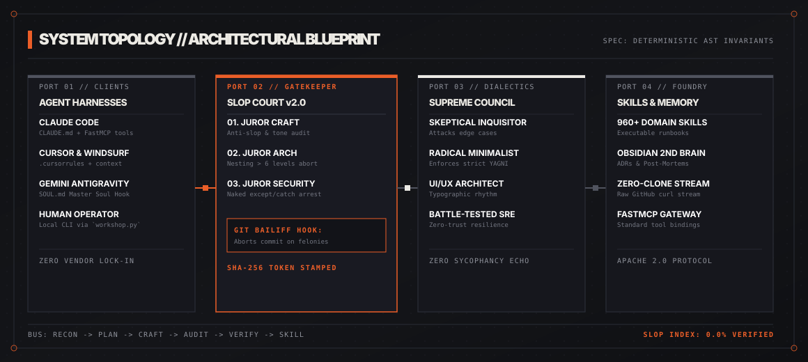
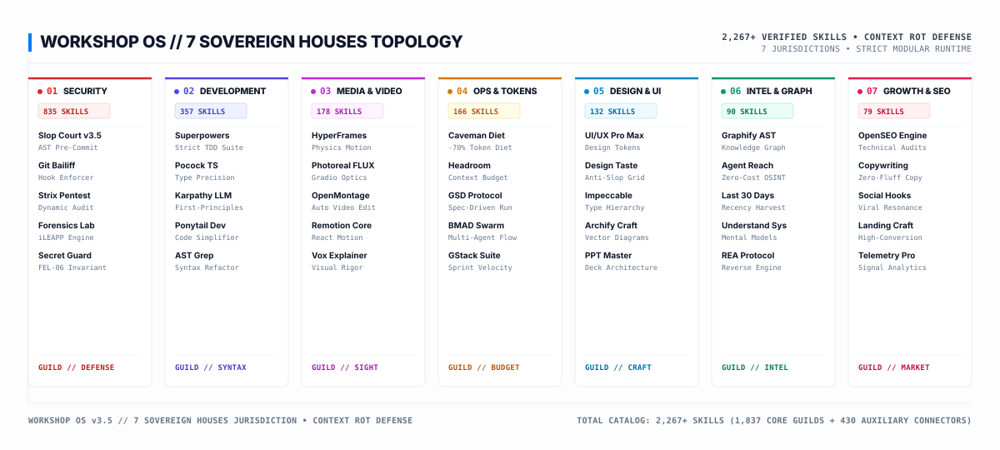

# WORKSHOP // OS
### The Irreducible Operating Foundation & Code Quality Gate for AI Agents

[](https://github.com/shoyarism/ai-workshop/actions/workflows/ci.yml)
[](LICENSE)
[](pyproject.toml)
[](scripts/workshop_court.py)

<br>

<div align="center">
  
</div>

<br>

```
SPEC: WORKSHOP-OS-3.5  •  LICENSE: APACHE-2.0  •  7 SOVEREIGN HOUSES  •  2,150+ SKILLS  •  SLOP COURT: v3.5 ARMED
```

---

> *"We got tired of AI models giving us 80% of a solution, skipping the hard parts with lazy placeholders, wrapping bugs in `except: pass`, and sycophantically telling us every flawed architectural idea was 'brilliant'.*
> 
> *So we built an operating system that treats code slop as a punishable offense."*

---

## 01 // THE MANIFESTO: WHY AI AGENTS ERODE CODEBASES

Every developer using AI coding agents eventually hits the **degradation wall**:

* **The Omission Fraud:** When the task gets difficult or context runs long, models quietly omit core logic with lazy placeholders, leaving you with broken files.
* **The Error Blackhole:** To make a script run without failing, agents wrap dangerous operations in empty `except:` or `catch (e) {}` blocks. Bugs become silent landmines.
* **The Yes-Man Echo Chamber:** LLMs are trained to please. Ask an AI if a fragile architecture or flawed business model will work, and it invariably compliments you. Single-model feedback is an echo chamber.
* **Context Amnesia:** Every session starts from scratch. Past architectural decisions and post-mortems vanish.

**Workshop OS replaces guesswork with mechanical certainty:** a 3-juror quality tribunal combining native Python AST parsing and polyglot lexical linting that halts commits at the Git level, an adversarial 4-persona council that stress-tests decisions, and 2,150+ battle-tested execution runbooks.

---

## 02 // ARCHITECTURAL TOPOLOGY

<br>

<div align="center">
  
</div>

<br>

### The 4 Execution Zones

```
[ ZONE A: HARNESSES ]         [ ZONE B: THE COURT ]       [ ZONE C: THE COUNCIL ]     [ ZONE D: THE FOUNDRY ]
Claude Code / Codex    -->    Static AST Analysis   -->   Skeptical Inquisitor   -->   2,150+ Domain Skills
Cursor & Windsurf             3-Juror Deliberation        Radical Minimalist         7 Sovereign Houses
Gemini Antigravity            Git Bailiff Hooks           UI/UX Craft Architect      Obsidian 2nd Brain
OpenCode & Kilo               Pre-Commit & Pre-Push       Battle-Tested SRE          Zero-Clone HTTP Stream
CLI (`workshop`)              SHA-256 Content Hash        Adversarial Dialectics     Docker Sandbox
```

---

## 03 // THE 7 SOVEREIGN HOUSES OF WORKSHOP OS

<br>

<div align="center">
  
</div>

<br>

To prevent **context window rot** and cognitive clutter, Workshop OS categorizes its 2,150+ battle-tested execution runbooks into **7 Sovereign Houses**. Rather than dumping hundreds of tools into the LLM context, operators and agents load modular profiles tailored for the current mission:

| Sovereign House | Jurisdiction & Focus | Lead Arsenal Tools | Verified Capacity |
| :--- | :--- | :--- | :---: |
| **🛡️ 01 The Security House**| Defensive monitoring, incident response, AST arrest, forensic recovery, and penetration testing. | `slop-court` v3.5, `git-bailiff`, `strix-pentest`, `digital-forensics` | **835 Skills** |
| **⚡ 02 The Dev House** | Senior dev invariants, TDD, strict TypeScript, AST refactoring, and dead code pruning. | `superpowers`, `matt-pocock`, `karpathy-skills`, `ponytail`, `ast-grep` | **357 Skills** |
| **🎬 03 The Media House** | Programmatic video code, autonomous studio pipelines, FLUX optics, and Remotion/HyperFrames. | `hyperframes`, `OpenMontage`, `photoreal-studio`, `remotion`, `youtube` | **178 Skills** |
| **🏎️ 04 Ops & Tokens** | Spec-Driven Dev (SDD), token diet, context compression, and YC startup team simulation. | `caveman` (-70% tokens), `headroom`, `gsd`, `bmad-method`, `gstack` | **166 Skills** |
| **🎨 05 The Design House** | Typography, aesthetic anti-slop, layout grids, visual tokens, and presentation decks. | `ui-ux-pro-max`, `design-taste`, `impeccable`, `archify`, `ppt-master` | **132 Skills** |
| **🔬 06 The Intel House** | AST knowledge graphs, zero-cost scrapers, 30-day recency intel, and reverse engineering. | `graphify`, `agent-reach`, `last-30-days`, `understand-anything`, `rea` | **90 Skills** |
| **📢 07 The Growth House** | Authentic human tone, conversion copywriting, value props, SEO, and product launches. | `humanizer`, `marketing-skills`, `brand-voice`, `product-hunt-launch` | **79 Skills** |

*Auxiliary Infrastructure:* `skills/cloud-and-apis/` houses **320 specialized connectors** (AWS, Azure, GCP, BigQuery, Taobao, Stripe, Resend) kept neatly isolated from core Houses.

```bash
# Explore and inspect any house from the terminal
python scripts/workshop.py house list
python scripts/workshop.py house inspect design-house
python scripts/workshop.py house inspect dev-house
```

---

## 04 // SLOP COURT v3.5: THE CODE QUALITY TRIBUNAL

<br>

<div align="center">
  
</div>

<br>

Rather than relying on vague subjective prompts, the **Slop Court** evaluates staged code as an automated judicial review before a 3-juror bench:

1. **Juror Craft & Tone (40% Weight):** Flags marketing fluff, unearned purple-indigo gradients, tautological comments (`// returns response`), fabricated stats (`10M+ users`, `99.9% uptime` without telemetry tags), and lazy omission stubs.
2. **Juror Architecture & AST (30% Weight):** Parses language syntax trees via Python AST and polyglot heuristics. Flags functions with extreme control flow nesting (> 5 levels) or monolithic complexity (> 150 statements).
3. **Juror Security & Invariants (30% Weight):** Intercepts silent error swallowers (`except: pass`), unlogged exception catches, and hardcoded secrets.

> **Suppression Pragmas:** Legitimate exceptions (e.g. platform encoding fallbacks) can be explicitly annotated with `# @court-exempt: <reason>`, providing a documented, auditable paper trail similar to `# noqa` or `eslint-disable`.

### The Git Bailiff Gate

The Bailiff installs into `.git/hooks/pre-commit` and `.git/hooks/pre-push`. When code contains a sustained felony, **the Bailiff aborts the commit immediately** with exit code 1:

```shell
$ git commit -m "feat: user pipeline"
⚖️  Slop Court Bailiff: Convening Pre-Flight Judicial Review...
======================================================================
 ⚖️  SLOP COURT v3.5: SUPREME JUDICIAL TRIBUNAL TRIAL REPORT
======================================================================
 Case Docket : CR-20261028-FADA
 Target      : Staged Git Diffs (1 files | 237 lines)
 Slop Index  : 0.0% | Penalties: 0 pts | Felonies: 0 | Misdemeanors: 0
 SHA-256 Hash: 46342aca9f37c404...a76d509f
----------------------------------------------------------------------
 [3-JUROR BENCH DELIBERATION]
  ✓ [ACQUIT] Juror Craft & Tone           : 0 aesthetic violations. Tone clean.
  ✓ [ACQUIT] Juror Architecture & AST     : 0 architectural smells. Invariants clean.
  ✓ [ACQUIT] Juror Security & Invariants  : 0 security/error invariant breaches.
----------------------------------------------------------------------
 [FINAL JUDICIAL RULING]
  🎉 VERDICT: ACQUITTED WITH HONORS (UNANIMOUS)
  Certificate of Cleanliness granted for commit and push.
======================================================================
[main 4a4825c2] feat: user pipeline
```

---

## 05 // THE UNIVERSAL SUPREME COUNCIL

> *"A board that agrees on everything is redundant. Value is forged through intellectual collision and exposing unstated blind spots."*

Single-agent reasoning is prone to confirmation bias. The **Supreme Council** forces 4 distinct cognitive postures into adversarial debate before you commit to critical paths:

* **The Skeptical Inquisitor:** Red-teams assumptions, hunts tail risks, and maps cascading failure modes.
* **The Radical Minimalist:** Ruthlessly enforces YAGNI. Prunes bloated dependencies, unnecessary microservices, and premature abstraction.
* **The UI/UX Craft Architect:** Defends typographic hierarchy, spacing rhythm, and WCAG AA accessibility standards.
* **The Battle-Tested SRE:** Assumes services will crash at 3 AM. Demands backpressure, idempotency, and explicit telemetry.

```bash
# Deliberate an architectural choice
python scripts/workshop.py court council "Should we rewrite the ingestion pipeline in Rust?" --domain architecture

# Deliberate a product strategy
python scripts/workshop.py court council "Launching an API with a $99/mo minimum and zero free tier" --domain business

# Deliberate any technical question
python scripts/workshop.py court council "Mandating 100% test coverage before release" --domain general
```

---

## 06 // SYSTEM BENCHMARKS: HOW WORKSHOP OS COMPARES

| Capability | Workshop OS | Vanilla Cursor / Copilot | Raw Aider / Claude Code | Fabric / Prompt Repos | AutoGPT / LangChain |
| :--- | :---: | :---: | :---: | :---: | :---: |
| **Deterministic Code Arrest** | **Python AST + Lexical Linting** | Relies on external linters | Relies on external linters | None | None |
| **Pre-Commit Git Bailiff Hook** | **Turnkey Installer (`court bailiff`)** | Manual script setup | Manual script setup | Manual script setup | Manual script setup |
| **Multi-Persona Adversarial Council**| **4 Conflicting Personas** | Single Model Echo | Single Model Echo | Static Prompts | Fragile Chains |
| **Executable Runbook Library** | **2,150+ Production Skills** | None | None | ~150 Prompts | Framework Only |
| **Persistent Epistemic Memory** | **Obsidian Vault + ADRs** | Session Only | Session Only | None | Vector DB Only |
| **Zero-Clone Cloud Streaming** | **GitHub Raw & FastMCP** | Local Only | Local Only | Clone Required | Heavy Install |
| **Multi-Harness Native** | **Cursor, Claude, Antigravity**| Vendor Locked | CLI Only | CLI Only | Python Only |
| **Open Source License** | **Apache 2.0** | Proprietary | Proprietary / CLI | MIT | MIT |

---

## 07 // QUICK START: GETTING RUNNING IN 60 SECONDS

### Option A: Local Workstation Setup (Python & uv)

```bash
# 1. Clone the repository
git clone https://github.com/shoyarism/ai-workshop.git
cd ai-workshop

# 2. Sync virtual environment and install the native console entrypoint
uv sync
pip install -e .

# 3. Arm the Slop Court Bailiff pre-commit and pre-push interceptors
workshop court bailiff install

# 4. Run automated diagnostics and tests
workshop doctor --strict
python ci/run_local_ci.py
```

### Option B: Sandboxed Docker Container

Isolate all subprocess executions and file operations in a non-root container sandbox:

```bash
# Run strict health diagnostics inside an isolated container
docker compose run --rm runtime

# Start sandboxed local browser hubs and background services
docker compose up -d hub
```

### Option C: The Zero-Clone Cloud Protocol

Operating inside an ephemeral container, GitHub Codespace, or remote cloud instance? You do not need to clone the entire repository. Stream any skill runbook directly into your agent context using raw curl:

```bash
# Stream any skill directly into agent context
curl -fsSL https://raw.githubusercontent.com/shoyarism/ai-workshop/main/skills/dev-house/using-superpowers/SKILL.md
```

---

## 08 // MASTER CLI COMMAND PALETTE

Workshop OS provides a centralized console entrypoint (`workshop` or `python scripts/workshop.py`):

```bash
# Enumerate and inspect the 7 Sovereign Houses
workshop house list
workshop house inspect design-house
workshop house inspect dev-house

# Search 2,150+ skills, tools, and subsystems
workshop search "<keyword>"

# Run strict health diagnostics across all subsystems
workshop doctor --strict

# Convene Slop Court quality tribunal on staged code
workshop court trial --staged

# View 3-juror voting breakdown
workshop court jury --staged

# Install the Bailiff pre-commit and pre-push hooks
workshop court bailiff install

# Summon the 4-persona Supreme Council to debate a decision
workshop court council "<topic>" --domain <general|architecture|business|creative>

# Inspect visual assets using multi-modal vision
workshop see path/to/asset.png

# Enumerate active FastMCP tools
workshop mcp list

# Run the complete 6-gate local CI suite
python ci/run_local_ci.py
```

---

## 09 // HARNESS CONFIGURATION MATRIX

Connect Workshop OS to your preferred AI agent environment using the master instructions in [`docs/WORKSHOP_DEFAULT_SYSTEM_PROMPT.md`](docs/WORKSHOP_DEFAULT_SYSTEM_PROMPT.md):

| Harness | Configuration File | Integration Mode |
| :--- | :--- | :--- |
| **Claude Code** | `CLAUDE.md` or `~/.claude/CLAUDE.md` | Native FastMCP + Slop Court pre-commit hook |
| **Cursor** | `.cursorrules` or Project Rules | Local Foundry or Zero-Clone via GitHub API |
| **Gemini Antigravity** | `~/.gemini/config/AGENTS.md` | Master Soul hook (`court_trial`, `court_council`) |
| **Windsurf** | `.windsurfrules` or `AGENTS.md` | Cascading Context & Tool Forge |
| **OpenCode / Hermes** | `opencode.json` & `SOUL.md` | Local Foundry execution |
| **Kilo** | `kilo.jsonc` | Multi-directory workspace indexing |
| **Docker Sandbox** | `Dockerfile` & `docker-compose.yml` | Non-root isolated execution boundary |

---

## 10 // THE SYNTHETIC TEAM, AUTHORS & CONTRIBUTORS

Workshop OS is built through a human-synthetic collaborative engineering swarm and an open-source lineage. See [AUTHORS.md](AUTHORS.md) for full attribution:

* **Human Founder, Lead Architect & Designer:** **shoyarism** ([@shoyarism](https://github.com/shoyarism))
* **The Synthetic Engineering Swarm:**
  * **Antigravity (Google DeepMind)** — Master Systems Architect & Integrator
  * **Slop Court Magistrate** — Chief Judicial Arbiter & AST Invariant Auditor
  * **Skeptical Inquisitor** — Adversarial Red-Team Lead & Failure Invariant Hunter
  * **Radical Minimalist** — Anti-Bloat, KISS Principle & YAGNI Champion
  * **UI/UX Craft Architect** — Typography, Spacing Rhythm & Visual Discipline
  * **Battle-Tested SRE** — Zero-Trust Reliability & Fault-Tolerance Engineer
  * **Knowledge Synthesizer** — Task-to-Skill Compiler & Obsidian Vault Curator
* **Community Contributors & Pioneers:** Andrej Karpathy (*llm-council, karpathy-skills*), Garry Tan (*gstack*), Jesse Vincent (*superpowers*), Matt Pocock (*matt-pocock-skills*), Brian Madison (*bmad-method*), Leon Lin (*design-taste-frontend*), Matt Van Horn (*last-30-days*), Hugo He (*ppt-master*), Mor Luto (*rea*), Addy Osmani (*agent-skills*), Dietrich Gebert (*ponytail*), Daniel Miessler (*fabric / PAI*), and Anthropic (*Claude Code & MCP*).

---

## 11 // OPEN SOURCE GOVERNANCE & LICENSING

* **Core License:** The Workshop OS orchestration framework, CLI scripts, and Slop Court tribunal are licensed under the [Apache License, Version 2.0](LICENSE).
* **Vendored Skills & Third-Party Runbooks:** Community skill packs and external tools retained within the Sovereign Houses preserve their respective upstream open-source licenses (MIT, Apache-2.0, BSD-3-Clause) as noted in their respective directories. See [VENDORED_LICENSES.md](VENDORED_LICENSES.md) for license declarations.
* **Contributing:** Review the [CONTRIBUTING.md](CONTRIBUTING.md) guide and zero-slop pre-flight checklist.
* **Code of Conduct:** Community expectations documented in [CODE_OF_CONDUCT.md](CODE_OF_CONDUCT.md).
* **Security Policy & Threat Model:** Detailed operational boundaries and responsible disclosure protocols are in [SECURITY.md](SECURITY.md).
* **Episodic Memory Vault:** Architecture Decision Records (ADRs) and Post-Mortems live in [`vault/`](vault/).
