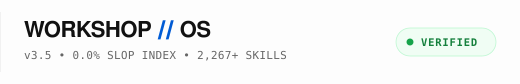

# WORKSHOP // OS

<div align="center">
  
  <p><strong>面向 AI 编码智能体的确定性运行底座与代码质量法庭</strong></p>

[](../../LICENSE)
[](../../pyproject.toml)
[](../../scripts/workshop_court.py)

[English](../../README.md) | [简体中文](README.zh-CN.md) | [日本語](README.ja.md) | [Español](README.es.md)

</div>

<br>

<div align="center">
  
</div>

<br>

<p align="center">
  <code>规范: WORKSHOP-OS-3.5</code> &nbsp;•&nbsp;
  <code>协议: APACHE-2.0</code> &nbsp;•&nbsp;
  <code>7 大领地主殿</code> &nbsp;•&nbsp;
  <code>2,147 验证技能</code> &nbsp;•&nbsp;
  <code>质量法庭: v3.5 就绪</code>
</p>

---

## 01 // 快速启动 (60 秒极速上手)

### 选项 A: 本地工作站配置 (推荐)

选择 `uv` (推荐) 或原生 `pip`:

```bash
# 1. 克隆代码库
git clone https://github.com/shoyarism/ai-workshop.git
cd ai-workshop

# 2. 安装依赖 (二选一)
uv sync                 # 使用 uv 时
pip install -e .        # 使用原生 pip 时

# 3. 部署 Git 预提交代码守卫 (Git Bailiff)
workshop court bailiff install

# 4. 运行系统全景健康检查与测试
workshop doctor --strict
pytest tests
```

### 选项 B: 零克隆云端直连模式 (Zero-Clone)

在临时容器或远程云实例中，直接使用 `curl` 实时获取技能执行手册：

```bash
curl -fsSL https://raw.githubusercontent.com/shoyarism/ai-workshop/main/skills/dev-house/using-superpowers/SKILL.md
```

---

## 02 // 核心理念: 为什么 AI 智能体会侵蚀代码库？

开发者在使用 AI 辅助编码时普遍面临四大**退化陷阱**:
1. **省略欺诈 (Omission Fraud):** 遇到复杂逻辑时，模型静默留下 `// ... 现有代码不变` 等懒惰占位符。
2. **异常黑洞 (Error Blackhole):** 为避免报错，AI 将危险调用包裹在空 `except: pass` 中，将错误转化为静默隐患。
3. **谄媚回音室 (Yes-Man Echo Chamber):** 模型倾向迎合用户，无法对脆弱架构提出尖锐反思。
4. **上下文健忘 (Context Amnesia):** 每次会话从零开始，过去的架构决策与修复经验荡然无存。

**Workshop OS 确立不可逾越的工程底线:** 通过基于 Python AST 静态语法树的 3-陪审员质量法庭拦截 Git 提交，辅以 4-人格对抗裁决委员会，将不可控的模型随机性约束为可验证的工程不变量。

---

## 03 // 7 大领地主殿 (Sovereign Houses)

为防御上下文窗口腐化，Workshop OS 将 **2,147 项已验证技能** 模块化划分为 7 大领地主殿：

| 领地主殿 | 管辖范围与职责 | 代表工具与技能 | 验证容量 |
| :--- | :--- | :--- | :---: |
| **🛡️ 01 安全主殿 (Security House)** | 防御监控、事件响应、AST 代码逮捕、渗透测试 | `slop-court` v3.5, `git-bailiff`, `digital-forensics` | **835 技能** |
| **⚡ 02 研发主殿 (Dev House)** | TDD 测试驱动、严格类型定义、AST 语法树重构 | `superpowers`, `matt-pocock`, `karpathy-skills`, `ast-grep` | **357 技能** |
| **🎬 03 媒体主殿 (Media House)** | 程序化视音频流水线、FLUX 光学、Remotion 动画 | `hyperframes`, `OpenMontage`, `photoreal-studio`, `remotion` | **178 技能** |
| **🏎️ 04 运维与算力主殿 (Ops & Tokens)** | 规范驱动开发 (SDD)、上下文瘦身、创业团队模拟 | `caveman` (节省70%标记), `headroom`, `gsd`, `gstack` | **166 技能** |
| **🎨 05 设计主殿 (Design House)** | 排版节奏、视觉抗泛滥规范、设计系统令牌 | `ui-ux-pro-max`, `design-taste`, `impeccable`, `archify` | **132 技能** |
| **🔬 06 情报主殿 (Intel House)** | 代码知识图谱、零成本抓取器、近30天动态追踪 | `graphify`, `agent-reach`, `last-30-days`, `rea` | **90 技能** |
| **📢 07 增长主殿 (Growth House)** | 自然人声文案、价值主张提炼、技术 SEO 与发布 | `humanizer`, `marketing-skills`, `brand-voice` | **79 技能** |

*辅助设施:* `skills/cloud-and-apis/` 包含 **320 个专用云服务连接器** (AWS, Azure, GCP, Stripe, Taobao)。

---

## 04 // 核心命令行指令

```bash
# 系统健康检查与诊断
workshop doctor --strict

# 检索 2,147 项技能
workshop search "<关键词>"

# 质量法庭: 审判暂存区代码
workshop court trial --staged

# 对抗委员会: 4-人格架构辩驳
workshop court council "是否应将核心数据存储迁移至 PostgreSQL?" --domain architecture
```

---

## 05 // 完整文档索引

* **[词汇表 (GLOSSARY.md)](../../GLOSSARY.md):** 核心架构术语与法典罪名全集。
* **[快速指南 (QUICKSTART.md)](../../QUICKSTART.md):** 完整环境配置与故障排查。
* **[基准性能测试 (BENCHMARKS.md)](../../BENCHMARKS.md):** 毫秒级延迟与内存占用指标。
* **[实战演练手册 (examples/)](../../examples/):** API 调用与流水线集成案例。
