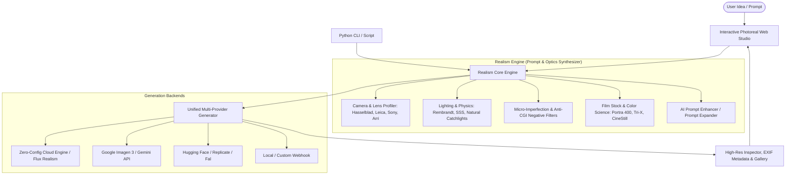

# Ultra-Realistic AI Image Generation System (Photoreal Studio)

A comprehensive system specifically engineered to bridge the "uncanny valley" and generate photorealistic AI images indistinguishable from real photography. The system combines an optical/photographic prompt synthesis engine, an AI prompt enhancer, multi-provider generation backends (instant zero-config cloud generation + custom API keys), curated master realism recipes, and an interactive modern Web Studio.

---

## User Review Required

> [!IMPORTANT]
> **Hardware & Inference Architecture**: Your local machine is equipped with an NVIDIA GeForce GTX 1650 (4 GB VRAM), which is constrained for running heavy local 16GB+ models like Flux.1 or SDXL locally without severe out-of-memory errors. 
> Therefore, this system is architected to use:
> 1. **Immediate Zero-Config Cloud Generation (Default)**: Out-of-the-box generation powered by high-fidelity cloud models (Flux.1 photorealism endpoints) requiring **no API keys** and **no local GPU load**.
> 2. **Pluggable Cloud Provider APIs**: Optional support for Google Imagen 3 / Gemini, Hugging Face Pro, Fal.ai, and Replicate for users with API keys.
> 3. **The Core Realism Synthesis Engine**: A modular prompt engineering & optics simulation pipeline that produces exact photographic prompts compatible with any image generator (Flux, Midjourney v6, Imagen 3, Stable Diffusion).

---

## System Architecture

---

## Key Realism Components

1. **Optics & Gear Profiler**:
   - Camera bodies: *Hasselblad H6D-100c, Leica M11-P, Sony α7R V, ARRI Alexa 35, Canon EOS R5*.
   - Matched prime lenses: *Zeiss Otus 85mm f/1.4, Leica Noctilux 50mm f/0.95, Voigtländer 35mm, Cooke Anamorphic /i*.
   - Depth of field, aperture control (f/1.2 to f/11), focal distance, optical bokeh shapes.

2. **Skin & Micro-Texture Physics**:
   - Authentic skin pores, subsurface scattering (light penetrating skin tissue), natural catchlights in irises.
   - Micro-imperfections: natural skin asymmetry, peach fuzz, realistic hair flyaways, fabric weave detail, subtle dust motes.

3. **Lighting Physics Engine**:
   - Directional Rembrandt key lighting with black flag negative fill.
   - Golden hour low sun angle, overcast diffused softbox, dusk chiaroscuro, natural indoor window spill.

4. **Negative Realism Shield**:
   - Prunes synthetic/airbrushed artifacts (plastic skin, 3D render sheen, unreal engine glossy look, oversaturated doll eyes, unnatural symmetry).

5. **Battle-Tested Master Realism Recipes**:
   - *National Geographic / Documentary Portrait* (weathered character, natural skin folds, ambient storytelling).
   - *High-Fashion Editorial* (35mm film grain, Hasselblad medium format sharpness, softbox lighting).
   - *Street Photography* (Leica 28mm, candid motion blur, CineStill 800T night halation).
   - *Macro / Product Realism* (depth of field, water droplets, authentic surface micro-scratches).
   - *Cinematic Movie Still* (anamorphic lens flare, Panavision 2.39:1 aspect ratio, cinematic grade).

---

## Proposed Changes

We will create a new dedicated project directory inside your scratch workspace at:
`~\.gemini\antigravity\scratch\ultra-realistic-image-studio`

### Core Engine & Backend

#### [NEW] `engine/photoreal_engine.py`
- Core Python classes for camera setups, lenses, lighting styles, film stocks, skin/surface micro-textures, and negative prompts.
- Method `synthesize_prompt(...)` combining subject, composition, optical setup, and negative filters into a balanced photoreal prompt.
- Curated master presets across 6 photographic genres.

#### [NEW] `engine/prompt_enhancer.py`
- Intelligent prompt expansion engine that takes brief user inputs (e.g. "elderly cobbler at work in Florence") and expands them into a cinematic, photorealistic description with proper sensory and spatial details.

#### [NEW] `backend/generator.py`
- Unified multi-provider image generation backend:
  - Default zero-config provider: Immediate high-resolution cloud generation without needing an API key.
  - Optional provider support: Google Imagen 3 / Gemini, Hugging Face, Replicate, Fal.ai.
  - Automatic download, metadata tagging, and local caching.

#### [NEW] `backend/server.py`
- Lightweight FastAPI web server:
  - API endpoints: `/api/synthesize`, `/api/enhance`, `/api/generate`, `/api/presets`, `/api/gallery`.
  - Static file serving for the web studio.

### Frontend Studio UI

#### [NEW] `frontend/index.html` & `frontend/app.js` & `frontend/style.css`
- Modern, sleek dark-mode glassmorphism interface:
  - **Prompt Editor**: Subject input + quick keyword chips + Realism Booster button.
  - **Photography Controls Panel**: Sliders and dropdowns for Camera Body, Lens/Focal Length, Aperture, Lighting Mood, Film Stock, and Micro-Imperfections.
  - **Preset Library**: One-click loading of iconic photography styles (National Geographic, Leica Street, Editorial Fashion, Cinematic Film).
  - **Live Prompt Preview**: Inspect generated positive and negative prompts in real time.
  - **Interactive Image Viewer**: Includes a 100% detail magnifying loupe to inspect pores, eyes, and textures.
  - **Generation History & Gallery**: Side-by-side comparisons, prompt copying, and one-click download.

### CLI & Utilities

#### [NEW] `cli.py`
- Command-line tool for developers:
  - Example: `python cli.py "portrait of a fisherman" --preset national_geographic --aspect 3:4`
  - Outputs the synthesized prompt and generates the image directly.

#### [NEW] `run_studio.bat` & `run_studio.py`
- Single-click launcher script to boot the web studio on `http://localhost:8000`.

---

## Open Questions

> [!NOTE]
> Please let us know your preference on the following points:
> 1. **Default Generation Provider**: Do you prefer to start with the **instant zero-config cloud generator** (ready to generate immediately without registering for keys), or do you already have an API key (e.g., Google Gemini / Imagen, Replicate, Fal.ai, or Hugging Face) that you want configured first?
> 2. **Primary Focus**: Is your priority human portraits, street & documentary scenes, cinematic film frames, or all-around photorealism?

---

## Verification Plan

### Automated & Unit Tests
1. **Engine Test**: Verify `synthesize_prompt()` generates structurally sound prompts with optics, lighting, and negative prompts.
2. **Generation Test**: Trigger a generation call to verify the backend receives, processes, and downloads a photorealistic image to disk.
3. **Server API Test**: Launch FastAPI test client and verify `/api/synthesize`, `/api/enhance`, and `/api/generate` return HTTP 200 with valid payloads.

### Manual Verification
1. Launch `python run_studio.py` and access `http://127.0.0.1:8000` in the browser.
2. Generate a test portrait using the *National Geographic* preset and inspect the skin texture, lighting catchlights, and bokeh.
3. Test the interactive photography sliders (aperture, camera body, lighting) and verify prompt updates dynamically.
