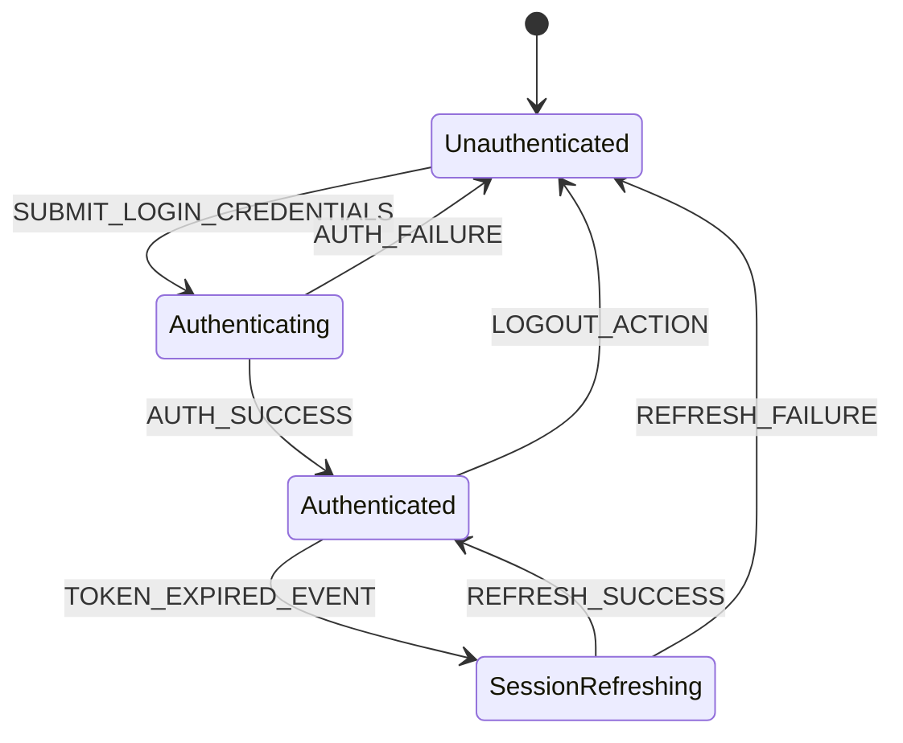

# Website Reconnaissance Output Schemas & Markdown Specifications

This document defines the formal JSON Schema Draft-07 specifications and AI-optimized Markdown templates for the four primary architectural artifacts generated during website reconnaissance and reverse-engineering:

1. **Endpoint Catalog & OpenAPI Specs** (`endpoint_catalog.json` & `ENDPOINT_CATALOG.md`)
2. **Component Dependency Graph** (`component_graph.json` & `COMPONENT_GRAPH.md`)
3. **State Machine Flowchart** (`state_machine.json` & `STATE_MACHINE.md`)
4. **Data Model Specification** (`data_model_spec.json` & `DATA_MODEL_SPEC.md`)

---

## 1. Endpoint Catalog Specification

### 1.1 JSON Schema: `endpoint_catalog.json`

```json
{
  "$schema": "http://json-schema.org/draft-07/schema#",
  "title": "EndpointCatalog",
  "description": "Formal specification for reconstructed backend API endpoints, HTTP contracts, and auth flows.",
  "type": "object",
  "required": ["baseUrl", "endpoints"],
  "properties": {
    "baseUrl": {
      "type": "string",
      "format": "uri",
      "description": "Canonical base URL for backend API operations."
    },
    "authentication": {
      "type": "object",
      "required": ["type"],
      "properties": {
        "type": {
          "type": "string",
          "enum": ["bearer", "oauth2", "cookie", "apiKey", "none"]
        },
        "headerName": { "type": "string" },
        "tokenLocation": { "type": "string" },
        "tokenScheme": { "type": "string" }
      }
    },
    "endpoints": {
      "type": "array",
      "items": {
        "type": "object",
        "required": ["path", "method", "parameters", "responses", "source"],
        "properties": {
          "path": {
            "type": "string",
            "description": "Parametrized path pattern (e.g. /api/v1/users/{userId})."
          },
          "method": {
            "type": "string",
            "enum": ["GET", "POST", "PUT", "PATCH", "DELETE", "HEAD", "OPTIONS"]
          },
          "summary": { "type": "string" },
          "source": {
            "type": "string",
            "enum": ["ast_discovered", "telemetry_intercepted", "hybrid"]
          },
          "inferred": { "type": "boolean" },
          "parameters": {
            "type": "array",
            "items": {
              "type": "object",
              "required": ["name", "in", "required", "type"],
              "properties": {
                "name": { "type": "string" },
                "in": {
                  "type": "string",
                  "enum": ["path", "query", "header", "cookie"]
                },
                "required": { "type": "boolean" },
                "type": { "type": "string" },
                "description": { "type": "string" }
              }
            }
          },
          "requestBody": {
            "type": "object",
            "required": ["contentType", "schema"],
            "properties": {
              "contentType": { "type": "string" },
              "schema": { "type": "object" }
            }
          },
          "responses": {
            "type": "object",
            "additionalProperties": {
              "type": "object",
              "required": ["description"],
              "properties": {
                "description": { "type": "string" },
                "contentType": { "type": "string" },
                "schema": { "type": "object" }
              }
            }
          }
        }
      }
    }
  }
}
```

### 1.2 Markdown Blueprint Template: `ENDPOINT_CATALOG.md`

````markdown
# API Endpoint Catalog & Reconstructed Contracts

**Base URL**: `https://api.targetdomain.com`  
**Authentication**: Bearer Token (`Authorization: Bearer <JWT>`)  
**Total Endpoints Discovered**: 12

---

## Global Authentication Flow
- **Token Type**: JSON Web Token (JWT)
- **Header Name**: `Authorization`
- **Claim Structure**: `{ "sub": "usr_8491", "roles": ["user", "admin"], "exp": 1785400000 }`

---

## Endpoint Specifications

### 1. GET `/api/v1/users/{userId}`

- **Summary**: Retrieve detailed user profile data.
- **Source**: `hybrid` (AST Discovered & Telemetry Intercepted)
- **Inferred**: `false`

#### Parameters
| Parameter | In | Type | Required | Description |
|---|---|---|---|---|
| `userId` | Path | `string (uuid)` | `true` | Unique identifier of target user |
| `includeStats` | Query | `boolean` | `false` | Include user activity metrics |

#### Request Body
*None (GET Request)*

#### Responses

##### HTTP 200 (OK)
- **Content-Type**: `application/json`
- **Schema**:
```json
{
  "$schema": "http://json-schema.org/draft-07/schema#",
  "type": "object",
  "required": ["id", "username", "email", "createdAt"],
  "properties": {
    "id": { "type": "string", "format": "uuid" },
    "username": { "type": "string" },
    "email": { "type": "string", "format": "email" },
    "createdAt": { "type": "string", "format": "date-time" }
  }
}
```

##### HTTP 401 (Unauthorized)
- **Content-Type**: `application/json`
- **Schema**: `{ "error": "Invalid or expired token" }`
````

---

## 2. Component Dependency Graph Specification

### 2.1 JSON Schema: `component_graph.json`

```json
{
  "$schema": "http://json-schema.org/draft-07/schema#",
  "title": "ComponentGraph",
  "description": "Formal specification for frontend component hierarchy, props, state listeners, and API bindings.",
  "type": "object",
  "required": ["rootComponent", "components"],
  "properties": {
    "rootComponent": { "type": "string" },
    "components": {
      "type": "array",
      "items": {
        "type": "object",
        "required": ["id", "name", "type", "children", "stateDependencies", "apiDependencies"],
        "properties": {
          "id": { "type": "string" },
          "name": { "type": "string" },
          "type": {
            "type": "string",
            "enum": ["page", "layout", "container", "presentational", "provider"]
          },
          "filePath": { "type": "string" },
          "props": {
            "type": "array",
            "items": {
              "type": "object",
              "required": ["name", "type", "required"],
              "properties": {
                "name": { "type": "string" },
                "type": { "type": "string" },
                "required": { "type": "boolean" }
              }
            }
          },
          "children": {
            "type": "array",
            "items": { "type": "string" }
          },
          "stateDependencies": {
            "type": "array",
            "items": { "type": "string" }
          },
          "apiDependencies": {
            "type": "array",
            "items": { "type": "string" }
          }
        }
      }
    }
  }
}
```

### 2.2 Markdown Blueprint Template: `COMPONENT_GRAPH.md`

````markdown
# Client Component Dependency Graph

**Root Component**: `AppLayout`  
**Total Components Discovered**: 8  

---

## Component Index

### 1. `DashboardPage` (`comp_dashboard_01`)
- **Type**: `page`
- **Source File**: `src/pages/DashboardPage.tsx`
- **Children**: `UserSummaryCard`, `AnalyticsChartWidget`, `HeaderNav`

#### Props Interface
| Prop Name | Type | Required |
|---|---|---|
| `initialUserData` | `UserProfileObject` | `true` |
| `themeMode` | `'light' | 'dark'` | `false` |

#### State Dependencies
- `userStore` (Zustand: `currentUser`, `isAuthenticated`)
- `analyticsStore` (Redux: `chartTimeRange`)

#### API Dependencies
- `GET /api/v1/users/{userId}`
- `GET /api/v1/analytics/summary`
````

---

## 3. State Machine Flowchart Specification

### 3.1 JSON Schema: `state_machine.json`

```json
{
  "$schema": "http://json-schema.org/draft-07/schema#",
  "title": "StateMachineFlowchart",
  "description": "Formal specification for client-side state stores, transitions, and side-effects.",
  "type": "object",
  "required": ["storeName", "type", "initialState", "states", "transitions"],
  "properties": {
    "storeName": { "type": "string" },
    "type": {
      "type": "string",
      "enum": ["redux", "zustand", "pinia", "context", "vuex"]
    },
    "initialState": { "type": "object" },
    "states": {
      "type": "array",
      "items": { "type": "string" }
    },
    "transitions": {
      "type": "array",
      "items": {
        "type": "object",
        "required": ["from", "to", "action", "sideEffects"],
        "properties": {
          "from": { "type": "string" },
          "to": { "type": "string" },
          "action": { "type": "string" },
          "sideEffects": {
            "type": "array",
            "items": { "type": "string" }
          }
        }
      }
    }
  }
}
```

### 3.2 Markdown & Mermaid Blueprint Template: `STATE_MACHINE.md`

````markdown
# Client State Machine & Transition Flowchart

**Store Name**: `AuthSessionStore`  
**Store Type**: `zustand`  

---

## State Transition Diagram



---

## State Transition Catalog

| From State | Action / Event | To State | Side Effects |
|---|---|---|---|
| `Unauthenticated` | `SUBMIT_LOGIN_CREDENTIALS` | `Authenticating` | Issue `POST /api/v1/auth/login` |
| `Authenticating` | `AUTH_SUCCESS` | `Authenticated` | Store Bearer Token in `localStorage`, Redirect to `/dashboard` |
| `Authenticating` | `AUTH_FAILURE` | `Unauthenticated` | Render error notification banner |
| `Authenticated` | `LOGOUT_ACTION` | `Unauthenticated` | Issue `POST /api/v1/auth/logout`, Clear session storage |
````

---

## 4. Data Model Specification

### 4.1 JSON Schema: `data_model_spec.json`

```json
{
  "$schema": "http://json-schema.org/draft-07/schema#",
  "title": "DataModelSpec",
  "description": "Formal specification for normalized entities, field attributes, and relationships.",
  "type": "object",
  "required": ["entities"],
  "properties": {
    "entities": {
      "type": "array",
      "items": {
        "type": "object",
        "required": ["name", "fields", "relationships"],
        "properties": {
          "name": { "type": "string" },
          "description": { "type": "string" },
          "fields": {
            "type": "array",
            "items": {
              "type": "object",
              "required": ["name", "type"],
              "properties": {
                "name": { "type": "string" },
                "type": { "type": "string" },
                "isPrimaryKey": { "type": "boolean" },
                "isNullable": { "type": "boolean" },
                "description": { "type": "string" }
              }
            }
          },
          "relationships": {
            "type": "array",
            "items": {
              "type": "object",
              "required": ["targetEntity", "type"],
              "properties": {
                "targetEntity": { "type": "string" },
                "type": {
                  "type": "string",
                  "enum": ["one-to-one", "one-to-many", "many-to-many"]
                },
                "foreignKey": { "type": "string" }
              }
            }
          }
        }
      }
    }
  }
}
```

### 4.2 Markdown Blueprint Template: `DATA_MODEL_SPEC.md`

````markdown
# Normalized Entity-Relationship Data Model

**Total Entities**: 2  

---

## Entities

### 1. `User` Entity
- **Description**: Represents a registered user account in the system.

#### Field Definitions
| Field Name | Type | Primary Key | Nullable | Description |
|---|---|---|---|---|
| `id` | `string (uuid)` | `true` | `false` | Unique user identifier |
| `email` | `string` | `false` | `false` | Account email address |
| `role` | `'user' | 'admin'` | `false` | `false` | Access control role |
| `createdAt` | `string (date-time)` | `false` | `false` | Account creation timestamp |

#### Relationships
| Target Entity | Relationship Type | Foreign Key |
|---|---|---|
| `Order` | `one-to-many` | `userId` |

---

### 2. `Order` Entity
- **Description**: Represents a commercial transaction created by a user.

#### Field Definitions
| Field Name | Type | Primary Key | Nullable | Description |
|---|---|---|---|---|
| `id` | `string (uuid)` | `true` | `false` | Unique order identifier |
| `userId` | `string (uuid)` | `false` | `false` | Foreign key referencing `User.id` |
| `totalAmount` | `number` | `false` | `false` | Total order monetary value |
| `status` | `'pending' | 'completed' | 'cancelled'` | `false` | `false` | Current order status |

#### Relationships
| Target Entity | Relationship Type | Foreign Key |
|---|---|---|
| `User` | `many-to-one` | `userId` |
````
