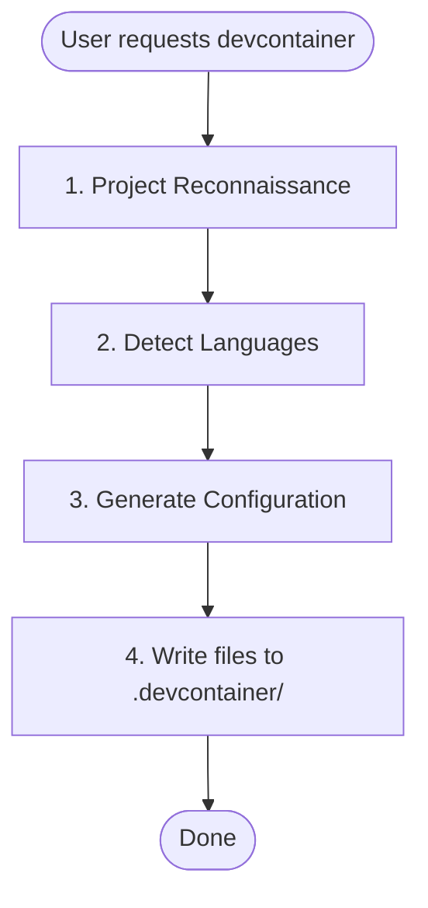

# Devcontainer Setup Skill

Creates a pre-configured devcontainer with Claude Code and language-specific tooling.

## When to Use
- User asks to "set up a devcontainer" or "add devcontainer support"
- User wants a sandboxed Claude Code development environment
- User needs isolated development environments with persistent configuration

## When NOT to Use

- User already has a devcontainer configuration and just needs modifications
- User is asking about general Docker or container questions
- User wants to deploy production containers (this is for development only)

## Workflow

## Phase 1: Project Reconnaissance

### Infer Project Name

Check in order (use first match):

1. `package.json` → `name` field
2. `pyproject.toml` → `project.name`
3. `Cargo.toml` → `package.name`
4. `go.mod` → module path (last segment after `/`)
5. Directory name as fallback

Convert to slug: lowercase, replace spaces/underscores with hyphens.

### Detect Language Stack

| Language | Detection Files |
|----------|-----------------|
| Python | `pyproject.toml`, `*.py` |
| Node/TypeScript | `package.json`, `tsconfig.json` |
| Rust | `Cargo.toml` |
| Go | `go.mod`, `go.sum` |

### Multi-Language Projects